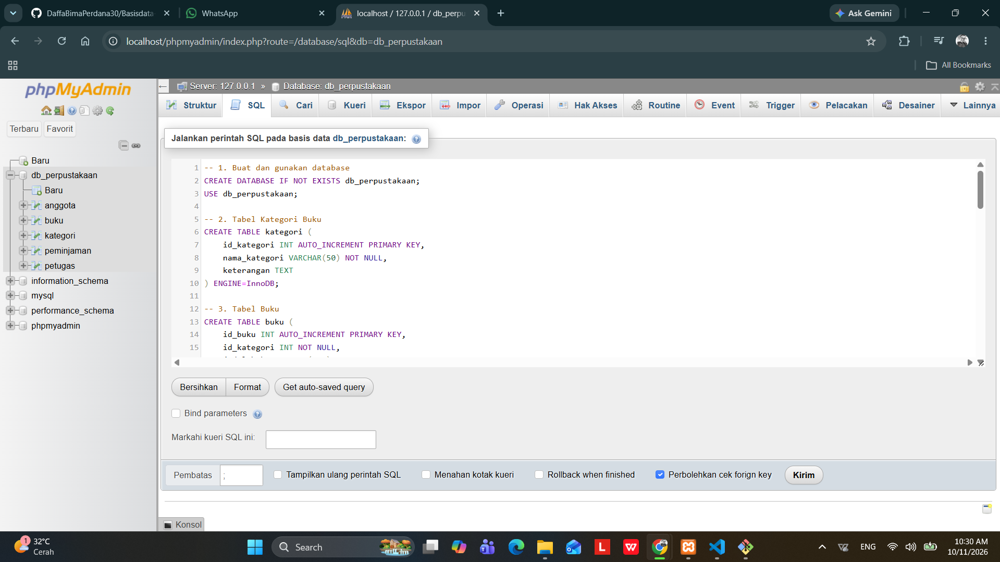
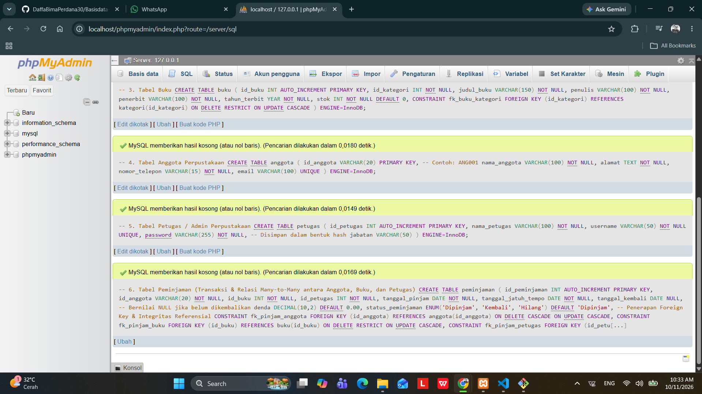
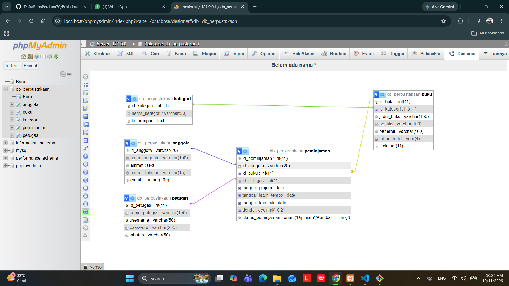
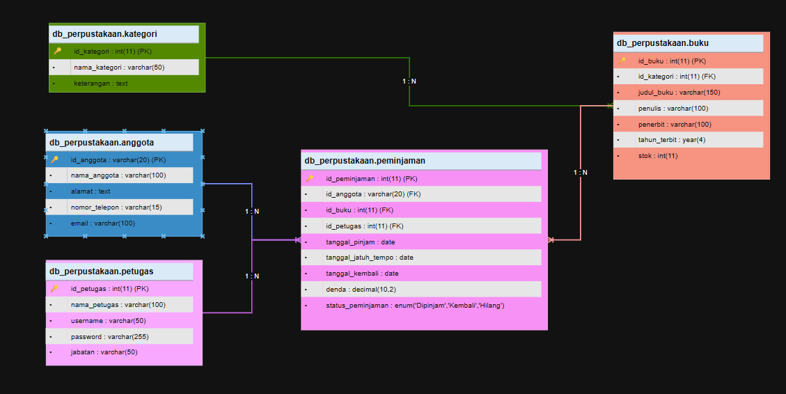

# Laporan Praktikum Basis Data - Pertemuan 03
* Nama : Daffa Bima Perdana
* NPM : 25430124
* Kelas : D
* Pertemuan Ke-03
* Tanggal Pelaksanaan : 07 Oktober 2026
* Dosen Pengampu : Dedi Irawan, S.Kom., M.T.I.

## 1. Tujuan Praktikum
1. Mampu merancang Entity Relationship Diagram (ERD) konseptual berdasarkan dokumen kebutuhan data proyek Perpustakaan.
2. Mampu mengimplementasikan skema relasi fisik ke database MySQL perpus_124 menggunakan phpMyAdmin.
3. Mampu menyelesaikan masalah relasi many-to-many (M:N) dengan menerapkan entitas asosiatif.

## 2. Ringkasan Teori

1.  **ERD** (Entity Relationship Diagram) adalah sebuah model atau diagram visual yang digunakan untuk menggambarkan struktur dari suatu database (basis data).
Diagram ini memperlihatkan komponen-komponen utama dalam sistem penyimpanan data serta bagaimana komponen-komponen tersebut saling terhubung satu sama lain.
    ### Komponen Utama dalam ERD
    Sebuah ERD umumnya terdiri dari tiga komponen dasar:

    * **Entitas (*Entity*):** Objek atau konsep di dunia nyata yang datanya ingin disimpan dalam database. Entitas biasanya direpresentasikan dalam bentuk **persegi panjang**.

    * **Atribut (*Attribute*):** Karakteristik atau properti yang mendeskripsikan suatu entitas. Atribut biasanya digambarkan dengan bentuk **elips**.

    * **Relasi (*Relationship*):** Hubungan atau asosiasi yang terjadi antara dua atau lebih entitas. Relasi digambarkan dengan bentuk **belah ketupat**.

    ### Derajat Relasi (Kardinalitas)

    Kardinalitas menentukan jumlah entitas yang dapat dihubungkan dengan entitas lain melalui sebuah relasi. Jenis-jenisnya meliputi:

    1. **One-to-One (1:1):** Satu entitas berhubung dengan tepat satu entitas lain.

    2. **One-to-Many (1:N):** Satu entitas dapat berhubungan dengan banyak entitas lain, tetapi sebaliknya tidak.

    3. **Many-to-Many (M:N):** Banyak entitas dapat berhubungan dengan banyak entitas lainnya.

    ### Fungsi dan Kegunaan ERD

    * **Perencanaan Database:** Membantu pengembang (*developer*) merancang struktur database sebelum diimplementasikan ke dalam bahasa pemrograman SQL.
    * **Dokumentasi Sistem:** Berfungsi sebagai cetak biru (*blueprint*) yang mempermudah pemahaman alur data bagi tim IT.
    * **Komunikasi:** Menjadi jembatan komunikasi antara perancang sistem dengan klien atau manajemen untuk memastikan kebutuhan data sudah sesuai.

2. Kardinalitas relasi adalah batasan atau jumlah maksimum kejadian suatu entitas yang dapat berelasi dengan kejadian pada entitas lainnya dalam sebuah Entity Relationship Diagram (ERD). 
Jenis-jenis kardinalitas relasi yaitu, One-to-one (1:1), One-to-many (i:N), Many-to-One (N:1), dan Many-to-Many (N:N).

3. Entitas asosiatif disebut juga sebagai junction entity atau intersecting entity adalah sebuah entitas khusus yang dibuat untuk menghubungkan dua atau lebih entitas yang memiliki relasi Many-to-Many (M:N).

    Dalam database relasional, hubungan Many-to-Many tidak dapat langsung diterjemahkan secara langsung ke dalam tabel fisik tanpa bantuan. Oleh karena itu, entitas asosiatif hadir sebagai jembatan untuk mengubah hubungan Many-to-Many menjadi dua buah hubungan One-to-Many (1:N).

* Karakteristik Utama Entitas Asosiatif 
    1. Identifikasi Ganda (Composite Primary Key): Biasanya, kunci utama (primary key) dari entitas asosiatif merupakan gabungan (composite key) dari foreign key (kunci tamu) yang berasal dari entitas-entitas induk yang dihubungkannya.
    2. Simbol ERD: Di dalam diagram ERD, entitas asosiatif sering digambarkan dengan simbol yang menggabungkan bentuk persegi panjang (entitas) dan belah ketupat (relasi), atau sering disebut juga sebagai box inside a diamond.

4. Integritas Referensial & Foreign Key
    * Integritas Referensial adalah sebuah aturan atau mekanisme yang diterapkan oleh Database Management System (DBMS) untuk menjaga konsistensi hubungan antar tabel yang dihubungkan oleh Foreign Key.

    * Foreign Key adalah sebuah kolom (atau sekumpulan kolom) dalam suatu tabel yang digunakan untuk menghubungkan tabel tersebut dengan Primary Key (Kunci Utama) di tabel lain.

## 3. Hasil Langkah Percobaan

### A. Membuat Tabel DDL pada phpMyAdmin

Pembuatan 5 tabel yaitu: anggota, kategori buku, buku, peminjaman, petugas. pada database perpus_124 dengan menggunakan akun mhs_124.

gambar diatas merupakan kueri skrip DDL SQL pada tab SQL phpMyAdmin sebelum dijalankan.

gambar diatas merupakan notifikasi sukses yang terbentuk pada basis data perpus_124.

### B. Verifikasi Relasi Fisik
Pemeriksaan keterhubungan foreign key antartabel pada menu Desainer phpMyAdmin.

gambar diatas merupakan tampilan visual relasi antartabel pada phpMyAdmin Desainer pada perpus_124.

## 4. Jawaban Titik Analisis
### 1. no_anggota dan nim_anggota sama-sama unik. Mengapa buku ini tetap memakai id_anggota sebagai kunci primer? Sebutkan satu risiko jika NIM dijadikan kunci primer.
* Meskipun no_anggota dan nim_anggota bersifat unik, penggunaan id_anggota (yang biasanya berupa surrogate key / kunci pengganti seperti auto-increment integer atau UUID) sebagai Kunci Primer (Primary Key) adalah standar praktik terbaik (best practice) dalam perancangan basis data relasional. Alasan menggunakan id_anggota adalah untuk memisahkan identitas sistem dari data bisnis, efisiensi performa dan indeks, dan fleksibilitas menampung anggota non-mahasiswa. Risiko utama jika NIM dijadikan kunci primer adalah data NIM dapat berpotensi berubah (mutable) karena berbagai alasan administratif seperti pindah jurusan, pindah program studi. Selain itu jika NIM dijadikan kunci primer akan memaksa sistem melakukan pembaruan massal pada semua tabel relasi yang mereferensikan (seperti tabel peminjaman, denda, dan lain-lain). Berisiko memicu penguncian basis data, performa yang menurun, dan hilangnya integritas referensial jika terjadi kegagalan proses.
### 2. Sisi penjualan terhadap detail_penjualan bernilai satu atau banyak, bukan nol atau banyak. Aturan bisnis mana yang memaksanya? Apakah aturan “minimal satu” ini dapat dijaga oleh struktur tabel saja?
* Aturan bisnis yang memaksa relasi ini bernilai minimal satu (mandatory participation) adalah aturan operasional transaksi ritel/penjualan, yaitu: Tidak sah atau tidak logis menerbitkan struk/nota penjualan kosong. Setiap transaksi penjualan (penjualan) secara logika bisnis wajib mencatat sekurang-kurangnya satu jenis barang yang dibeli (detail_penjualan). Dalam pemodelan ERD, ini disebut sebagai Partisipasi Wajib (Mandatory Participation) pada sisi hubungan entitas, di mana keberadaan suatu entitas anak (detail_penjualan) mutlak diperlukan untuk melengkapi entitas induknya (penjualan). aturan "minimal satu" tidak secara sempurna karena terdapat kendala urutan penyisipan dan keterbatasan check constraint.

### 3. Ketua ingin mengetahui “petugas gudang mana yang menerima barang dari pemasok”. Apakah ERD saat ini dapat menjawabnya? Jika belum, relasi apa yang perlu ditambahkan, dan apakah keputusan itu perlu dicatat sebagai aturan bisnis baru?
* saat ini ERD belum tentu bisa menjawab karena dalam rancangan ERD untuk sistem perpustakaan, Dalam rancangan ERD standar perpustakaan, tabel transaksi seperti peminjaman atau pengembalian biasanya hanya menghubungkan antara entitas anggota dan buku. Jika atribut atau relasi yang merujuk ke identitas staf (id_petugas atau id_pegawai) belum ada pada tabel transaksi tersebut, maka sistem tidak akan dapat melacak siapa petugas perpustakaan yang melayani sirkulasi buku tersebut.
* Relasi Apa yang perlu ditambahkan adalag relasi hubungan antara entitas petugas dengan entitas transaksi peminjaman/pengembalian. Implementasi Teknis Tambahkan Foreign Key berupa id_petugas di dalam tabel peminjaman dan/atau pengembalian
* perlu dicatat sebagai aturan bisnis baru yang dapat dirumuskan: Setiap transaksi peminjaman maupun pengembalian buku wajib mencatat identitas petugas perpustakaan yang bertugas melayani, guna memastikan transparansi, akuntabilitas pelayanan, serta pencatatan rekam jejak (audit trail) sirkulasi koleksi perpustakaan.

## 5. Hasil Latihan dan Modifikasi
### 1. Analisis Kebutuhan Poin / Reward Pelanggaran (Atau Poin Keaktifan Anggota)
* Keputusan: Perlu entitas terpisah bernama riwayat_poin (atau riwayat_denda/riwayat_sanksi), tidak cukup hanya menjadi atribut pada entitas anggota. alasannya: Jika poin/denda hanya menjadi atribut saldo di tabel anggota, sistem kehilangan jejak riwayat mutasi (kapan poin bertambah/berkurang serta dari transaksi peminjaman atau pengembalian buku nomor berapa poin tersebut dihasilkan). Entitas riwayat_poin mencatat riwayat transaksi secara detail (id_anggota, id_peminjaman, jumlah_poin, jenis_mutasi, tanggal), sehingga mendukung transparansi audit data transaksi perpustakaan.

### 2. Analisis Relasi Peminjaman–Buku Banyak-ke-Banyak (M:N) Langsung
* Data yang Hilang:
    * Atribut batas waktu pengembalian atau tanggal jatuh tempo spesifik per buku.
    * Atribut kondisi fisik buku saat dipinjam/dikembalikan (misal: baik, robek, atau hilang per eksemplar).
    * Status pengembalian per item buku.
* Alasan: Relasi $M:N$ fisik tanpa tabel perantara (tabel detail peminjaman) tidak memiliki tempat untuk menyimpan data atribut transaksional per item buku yang dipinjam tanpa melanggar aturan normalisasi basis data.

## 6. Tugas Mandiri : Milestone Proyek  03
### A. Diagram ERD Proyek Perpustakaan

* berkas mentah : p03_erd_225430124.drawio

### B. Tabel Relasi dan Kardinalitas

### C. Tabel Kebutuhan Informasi (KI) Ke Jalur ERD

### D. Penerapan Entitas Asosiatif
### E. Catatan Tinjauan Klien

## 7. Pembahasan dan Kendala

## 8. Kesimpulan

## 9. Pernyataan Penggunaan AI

Pada Praktikum 03 ini AI yang digunakan untuk membantu pembuatan laporan ini adalah Gemini dan chatPGT yang digunakan untuk sarana konsultasi skrip SQL, asistensi sintaksis DDL SQL, pengecekan kerapihan penulisan laporan,serta pengambilan tangkapan layar sebagai bukti dijalankannya skrip pada komputer lokal.

## 10. Bukti Git
Tautan Repositori : https://github.com/DaffaBimaPerdana30/Basisdata-25430124

## Checklist Laporan Praktikum (Umum)

| Butir | Yang Harus Ada | Status |
| :--- | :--- | :---: |
| Identitas | Nama, NPM, kelas, pertemuan ke-3, tanggal pelaksanaan, nama dosen/asisten | [x] |
| Tujuan | Tujuan praktikum ditulis ulang dengan bahasa sendiri (maksimal 5 baris) | [x] |
| Ringkasan teori | Pemahaman sendiri atas Dasar Teori, maksimal setengah halaman | [x] |
| Langkah percobaan (D) | Tangkapan layar hasil langkah kunci diberi keterangan singkat | [x] |
| Titik Analisis | Semua Titik Analisis dijawab lengkap dengan alasan | [x] |
| Latihan (E) | Skrip/dokumen hasil latihan beserta bukti berjalan | [x] |
| Tugas Mandiri (F) | Milestone proyek pertemuan ini: berkas, bukti, dan penjelasan keputusan desain | [x] |
| Pembahasan dan kendala | Galat yang ditemui, cara membacanya, dan cara mengatasinya | [x] |
| Kesimpulan | Dua sampai empat kalimat dengan bahasa sendiri | [x] |
| Pernyataan Penggunaan AI | Alat yang dipakai, untuk apa, bagian mana | [x] |
| Bukti Git | Tautan repositori dan kode commit (hash) | [x] |
| Keaslian | Tangkapan layar memperlihatkan akun ber-NPM dan jam sistem | [x] |

## Tabel 2.9 Checklist Khusus Laporan Pertemuan 3

| Jenis | Yang harus ada | Status |
| :--- | :--- | :---: |
| **Berkas wajib** | `p03_erd_25430115.md` (proyek) | [x] |
| **Bukti tangkapan layar** | Tabel PB, AB, KI, matriks CRUD, dan kamus data di berkas proyek (tangkapan tampilan GitHub) | [x] |
| **Analisis wajib** | Titik Analisis 1–3; perhitungan parameter P; perbaikan tiga pernyataan kebutuhan kabur | [x] |

