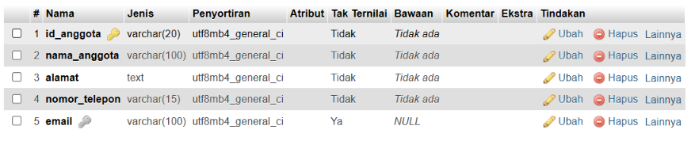
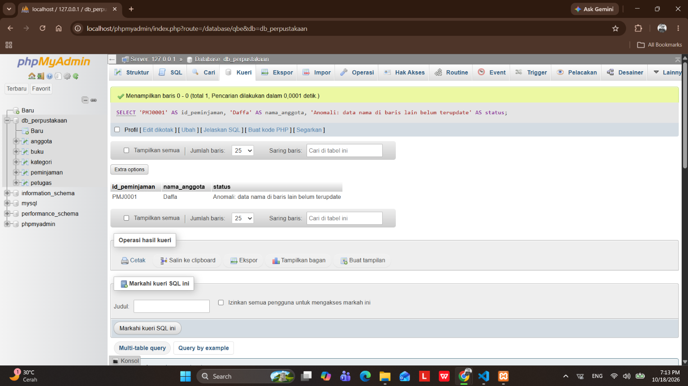
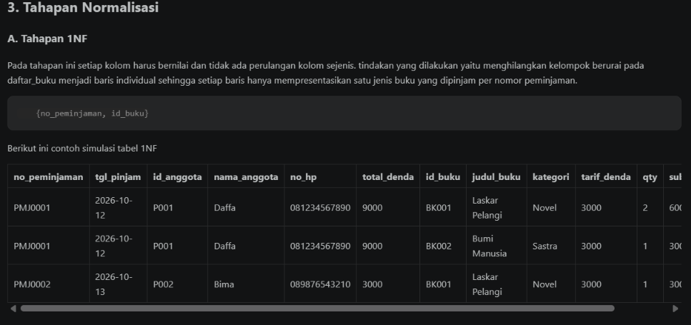
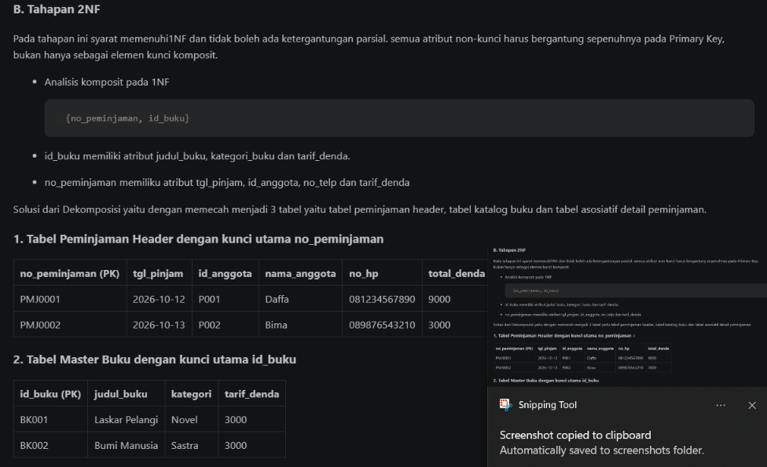
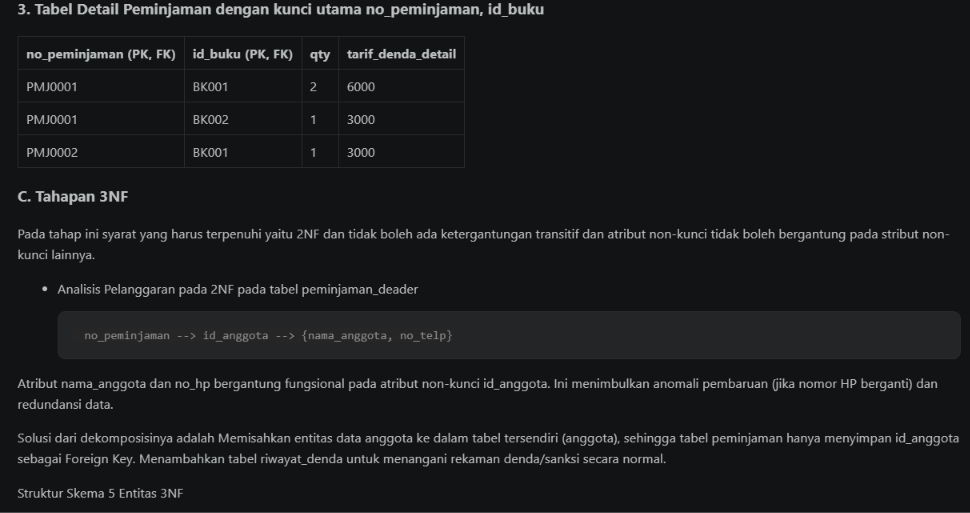
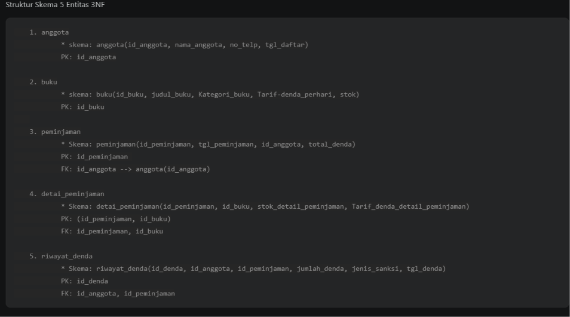
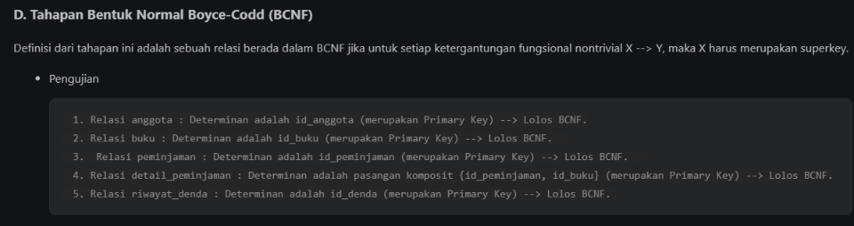

# Laporan Praktikum Basis Data - Pertemuan 04
* Nama : Daffa Bima Perdana
* NPM : 25430124
* Kelas : D
* Pertemuan Ke-04
* Tanggal Pelaksanaan : 14 Oktober 2026
* Dosen Pengampu : Dedi Irawan, S.Kom., M.T.I.

## 1. Tujuan Praktikum
* Dapat mengidentifikasi fungsionel penuh, parsial dan stransitif pada sumber data.
* Dapat menginplementasikan tahapan dekomposisi skema relasi dari UNF hingga 3NF
* Dapat menentukan kalkulasi nilai turunan atau derived attributes.
* Dapat menjamin integritas skema basis data proyek perpustakaan dari anomali redundansi, penyisipan, pengubanan dan penghapusan data.

## 2. Ringkasan Teori

Normalisasi merupakan teknik perancangan basis data relasional untuk mengorganisasi tabel. Tujuannya yaitu untuk mengurani redundansi data dan mencegah adanya anomali seperti insert, update dan delete. normalisasi ini memiliki dasar utama dengan menggunakan konsep dependensi fungsional (X--> Y), nilai determinan X secara unik menentukan nilai dependen Y.

Tahapan bentuk normalisasi dalam perancangan basis data relasional umumnya dibagi menjadi beberapa tingkatan, yaitu:

* Bentuk normal pertama (1NF) bentuk ini memiliki syarat setiap kolom dalam tabel harus bernilai atomik (tidak dapat dibagi lagi menjadi bagian yang lebih kecil) dan tidak ada atribut bernilai ganda (multi-valued attributes). Setiap sel tabel hanya menyimpan satu nilai tunggal.
* Bentuk normal kedua (2NF) bentuk ini memiliki syarat harus sudah memenuhi 1NF dan tidak ada dependensi parsial. Artinya, semua atribut non-kunci harus bergantung sepenuhnya pada primary key secara utuh (bukan hanya bergantung pada sebagian dari composite primary key).
* Bentuk normal ketiga (3NF) bentuk ini memilik syarat harus sudah memenuhi 2NF dan tidak ada dependensi transitif. Artinya, tidak boleh ada atribut non-kunci yang bergantung pada atribut non-kunci lainnya (X -> Y -> Z).
* Bentuk Normal Boyce-Codd (BCNF) bentuk ini memiliki syarat Setiap determinan (sisi kiri dari dependensi fungsional X --> Y) pada relasi harus merupakan sebuah candidate key.

## 3. Hasil Percobaan
### A. Pengujian Struktuk Kunci
Pemeriksaan struktur tabel

### B. Pengujian Anomali Pengubahan

## 4. Titik Analisis
* Mengapa FD5 menempatkan harga_satuan_detail_penjualan pada kunci (no_nota_penjualan, kode_barang), bukan pada kode_barang saja? harga barang di tabel barang(kode_barang) dapat berubah sewaktu-waktu. menempatkan harga_satuan_detai_penjualan di tabel detail transaksi (no_nota_penjualan, kode_barang) berfungsi sebagai mencatat harga resmi barang pada saat transaksi itu terjadi. Apa yang terjadi pada laporan omzet tahun lalu jika harga_satuan_detail_penjualan dipindah ke tabel barang? Jika harga_satuan_detail_penjualan hanya ada di tabel barang, maka ketika harga barang dinaikkan atau diturunkan hari ini, nilai total pada nota-nota penjualan di masa lalu otomatis ikut berubah mengikut harga baru.

* Keputusan "total tidak disimpan" akan ditinjau ulang di Buku 2 Modul 2, ketika tabel arsip penjualan justru menyimpan total. Mengapa keputusan yang berbeda itu tetap konsisten? Petunjuk: bedakan data operasional yang masih dapat berubah dari potret historis yang tidak boleh berubah. Pada tabel operasional/OLTP Data operasional bersifat aktif, sering mengalami perubahan (CRUD: Create, Read, Update, Delete), dan mengutamakan integritas data serta penghilangan redundansi (normalisasi). Pada tabel arsip/OLAP Data arsip berfungsi sebagai potret historis (snapshot) yang bersifat read-only (hanya dibaca) dan tidak akan pernah diubah lagi.
* Kolom pemasok_brg di spreadsheet lama tidak muncul di tabel barang. Di mana
informasi “barang ini dipasok oleh siapa” kini disimpan? Apa keuntungannya dibanding menyimpan satu nama pemasok di tabel barang? Informasi pemasok barang kini tidak disimpan langsung di tabel barang, melainkan dicatat melalui relasi antara tabel pembelian dan detail_pembelian: tabel pembelian untuk menyimpan kolom kunci tamu id_pemasok, tabel detail_pembelian menghubungkan id_pembelian dengan id_barang. Keuntungannya dibanding menyimpan satu nama pemasok di tabel barang yaitu mendukung pemasok jamak (Many-to-Many), dapat menyimpan rekam jejak riwayat transaksi pasokan dan mencegah redundansi dan anomali data.

## 5. Hasil Latihan
### 1. Normalisasi Entitas Anggota dengan BanyaK Nomor Telepon dan Email
* Salah satu kasus yaitu suatu anggota memiliki lebih dari satu nomor dan email aktif. Menyimpan nomor dan email dalam satu kolom teks melanggar 1NF  dan membuat kolom berulang yang menjadikan kasus tersebut melanggar prinsip skalabilitas relasional. Solusinya adalah: anggota(id_anggota, nama_anggota, tanggal_daftar) --> PK: id_anggota. telepon_anggota(id_telepon, id_anggota, no_telepon, jenis_kontak) --> PK: id_telepon, FK: id_anggota merujuk anggota(id_anggota) ON DELETE CASCADE
### 2. Contoh Data Pelanggaran 3NF dan Pembuktian Anomali Update
* Contoh tabel melanggar 3NF

| id_peminjaman | tgl_peminjaman | id_anggota | nama_anggota | total_denda |
| :--- | :--- | :--- | :--- | :--- |
| PMJ0001 | 2026-10-05 | P001 | Daffa |8000 |
| PMJ0002 | 2026-10-08 | P002 | Bima | 12000 |
| PMJ00003 | 2026-10-21 | P001 | Daffa | 0 |

* Ketergantungan transitifnya: id_peminjaman --> id_anggota --> nama_anggota
* Kueri yang menimbulkan anomali:

        UPDATE peminjaman
        SET nama_anggota = 'Daffa'
        WHERE id_peminjaman = 'PMJ0001';

* Bukti 

## 6. Tugas Mandiri
Seluruh analisis dokumen sumber UNF, pemetaan dependensi fungsional kode AB, dekomposisi bertahap 1NF --> 2NF --> 3NF, audit BCNF, serta keputusan nilai turunan untuk basis data perpus_124. pada berkas: p04_normalisasi_25430124.md

## 7. Pembahasan dan Kendala
Pemahaman atribut historis transaksi vs atribut turunan (contoh: tarif_denda_detail_peminjaman). solusi dari pemahaman Tarif denda master bisa berubah di masa depan, sehingga tabel detail wajib menyimpan tarif denda saat transaksi sebagai rekaman historis (snapshot). 
## 8. Kesimpulan
roses normalisasi pada skema basis data Pelayanan Perpustakaan perpus_124 berhasil memvalidasi kelima entitas (anggota, buku, peminjaman, detail_peminjaman, dan riwayat_denda) hingga tahap 3NF dan BCNF. Dengan pemisahan tabel master, transaksi, dan relasi asosiatif, sistem terbebas dari dependensi parsial dan transitif serta menjamin integritas data terhadap potensi anomali.

## 9. Pernyataan Penggunaan AI

Pada Praktikum 03 ini AI yang digunakan untuk membantu pembuatan laporan ini adalah Gemini dan chatPGT yang digunakan untuk sarana konsultasi skrip SQL, asistensi sintaksis DDL SQL, pengecekan kerapihan penulisan laporan,serta pengambilan tangkapan layar sebagai bukti dijalankannya skrip pada komputer lokal.

## 10. Bukti Git
Tautan Repositori : https://github.com/DaffaBimaPerdana30/Basisdata-25430124

Berkas milestone : p04_normalisasi_25430124.md

---

## Checklist Laporan Praktikum (Umum)

| Butir | Yang Harus Ada | Status |
| :--- | :--- | :---: |
| Identitas | Nama, NPM, kelas, pertemuan ke-4, tanggal pelaksanaan, nama dosen/asisten | [x] |
| Tujuan | Tujuan praktikum ditulis ulang dengan bahasa sendiri (maksimal 5 baris) | [x] |
| Ringkasan teori | Pemahaman sendiri atas Dasar Teori, maksimal setengah halaman | [x] |
| Langkah percobaan (D) | Tangkapan layar hasil langkah kunci diberi keterangan singkat | [x] |
| Titik Analisis | Semua Titik Analisis dijawab lengkap dengan alasan | [x] |
| Latihan (E) | Skrip/dokumen hasil latihan beserta bukti berjalan | [x] |
| Tugas Mandiri (F) | Milestone proyek pertemuan ini: berkas, bukti, dan penjelasan keputusan desain | [x] |
| Pembahasan dan kendala | Galat yang ditemui, cara membacanya, dan cara mengatasinya | [x] |
| Kesimpulan | Dua sampai empat kalimat dengan bahasa sendiri | [x] |
| Pernyataan Penggunaan AI | Alat yang dipakai, untuk apa, bagian mana | [x] |
| Bukti Git | Tautan repositori dan kode commit (hash) | [x] |
| Keaslian | Tangkapan layar memperlihatkan akun ber-NPM dan jam sistem | [x] |

## Tabel 2.9 Checklist Khusus Laporan Pertemuan 3

| Jenis | Yang harus ada | Status |
| :--- | :--- | :---: |
| **Berkas wajib** | `p04_erd_25430124.md` (proyek) | [x] |
| **Bukti tangkapan layar** | Tabel PB, AB, KI, matriks CRUD, dan kamus data di berkas proyek (tangkapan tampilan GitHub) | [x] |
| **Analisis wajib** | Titik Analisis 1-3; perhitungan parameter P; perbaikan tiga pernyataan kebutuhan kabur | [x] |