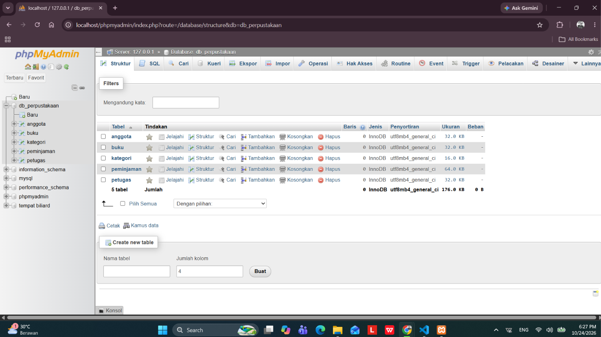
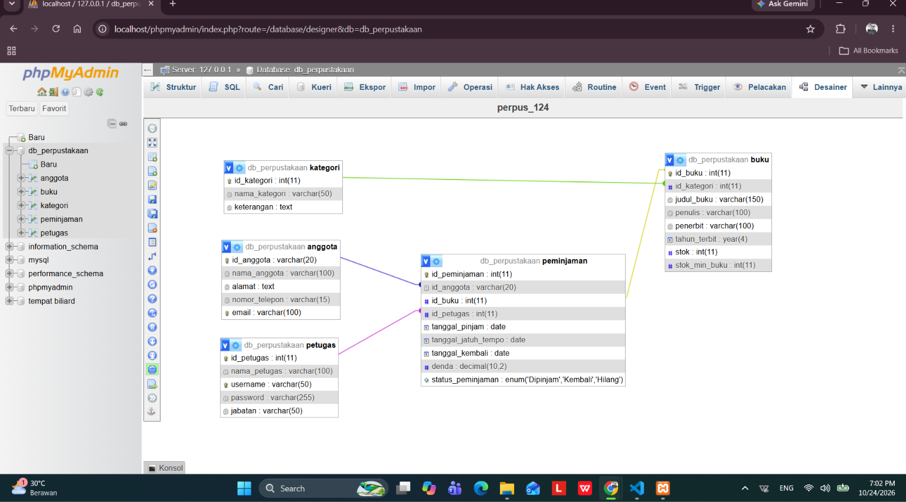
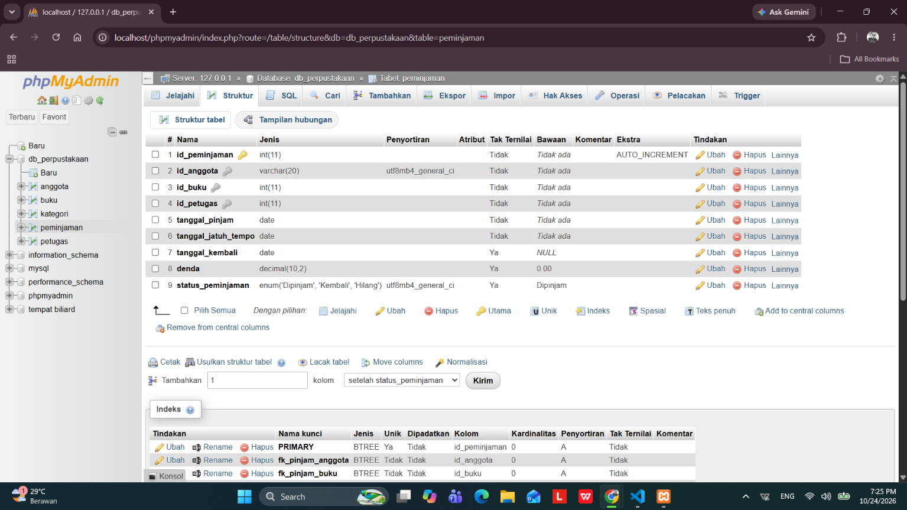
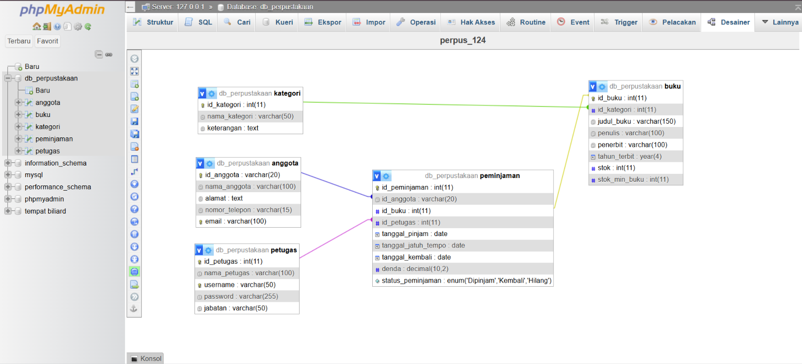

# Laporan Praktikum Basis Data - Pertemuan 05
* Nama : Daffa Bima Perdana
* NPM : 25430124
* Kelas : D
* Pertemuan Ke-05
* Tanggal Pelaksanaan : 21 Oktober 2026
* Dosen Pengampu : Dedi Irawan, S.Kom., M.T.I.

## 1. Tujuan Praktikum
1. Mahasiswa mampu mengimplementasikan rancangan fisik basis data ke dalam DDL (Data Definition Language) SQL.
2. Mahasiswa mampu mendefinisikan Primary Key, Composite Key, serta Foreign Key dengan opsi aksi referensial ON DELETE dan ON UPDATE yang tepat.
3. Mahasiswa mampu menerapkan batasan data dengan menggunakan CHECK constraint susuai dengan bisnis sistem.
4. Mahasiswa mampu menganalisis keselarasan skema fisik dengan prinsip kepatuhan hukum perlindungan data pribadi (UU PDP).

## 2. Ringkasan Teori
Data Definition Language (DDL) adalah salah satu sub-bahasa SQL yang memiliki fungsi utama untuk mendefinisikan, mengubah, serta mengelola struktur dari berbagai objek yang ada di dalam sebuah basis data.

Fokus utama dari DDL ini adalah berfokus secara khusus pada kerangka kerja, skema, atau cetak biru dari objek basis data itu sendiri.

Secara umum, perintah-perintah yang termasuk dalam kelompok DDL meliputi:
* CREATE: Digunakan untuk membuat objek baru di dalam basis data (misalnya membuat tabel atau database baru)
* ALTER: Digunakan untuk mengubah struktur objek yang sudah ada (misalnya menambah atau menghapus kolom pada tabel).
* DROP: Digunakan untuk menghapus objek dari basis data secara permanen.
* TRUNCATE: Digunakan untuk mengosongkan seluruh data di dalam tabel tanpa menghapus struktur tabel itu sendiri.

## 3. Langkah Percobaan
### A. Eksekusi DDL Pembentukan Basis Data
Berikut ini hasil DDL pembentukan Basis data perpus_124

### B. Pemeriksaan Hubungan Foreign Key dan Primary Keu
Berikut ini adalah tampilan dari phpMyAdmin Desiner dari perpus_124

## 4. Jawaban Titik Analisi
1. Mengapa fk_detail_penjualan memakai ON DELETE CASCADE, sedangkan
fk_detail_barang tidak? Apa yang terjadi pada laporan penjualan lama jika barang
boleh dihapus beserta seluruh detailnya?

        1. Penggunaan ON DELETE CASCADE pada fk_detail_penjualan:   
            * Tabel detail_penjualan adalah entitas lemah (weak entity) atau bagian tak terpisahkan dari header transaksi penjualan.   
            * Jika satu rekaman transaksi induk (penjualan) dihapus, maka seluruh rincian barang dalam nota tersebut (detail_penjualan) harus ikut terhapus otomatis agar tidak menjadi data yatim (orphan data).   
        2. Pengalihan tanpa ON DELETE CASCADE (default/RESTRICT) pada fk_detail_barang:   
            * Tabel barang adalah data master yang mendasari berbagai riwayat transaksi.   
            * Jika sebuah barang pernah dijual, barang tersebut tidak boleh langsung dihapus secara otomatis dari sistem jika masih tercatat dalam transaksi yang pernah terjadi. Hal ini untuk mencegah terhapusnya riwayat transaksi penjualan terdahulu hanya karena data master barang dihapus.
        3. Kehilangan Integritas Data Riwayat (Data Loss): Jika barang dihapus dan sistem mengizinkan pembersihan otomatis hingga ke detail_penjualan, maka seluruh item transaksi masa lalu yang memuat barang tersebut akan ikut terhapus.
        4. Laporan Penjualan Menjadi Tidak Akurat / Rusak:Total Nilai Transaksi Tidak Cocok: 
            * Jumlah total pada header penjualan (bayar_penjualan) tidak akan cocok lagi dengan jumlah rincian barang di detail_penjualan.   
            * Laporan Keuangan & Stok Rusak: Laporan statistik penjualan bulanan/tahunan akan kehilangan data item barang yang pernah terjual, sehingga angka penjualan dan analisis riwayat barang terlaris menjadi salah atau hilang.

2. Kode galat 1452, 4025, dan 1062 muncul pada tiga percobaan di atas. Petakan setiap kode ke
aturan bisnis (AB-xx) yang dilindunginya. Aturan bisnis Kopma mana yang belum dapat
dijaga oleh constraint apa pun?
        
        Pemetaan Kode Galat ke Aturan Bisnis
        * Kode Galat 1452:
            Penyebabnya adalah pelanggaran Foreign Key Constraint (Kunci Tamu).
            Aturan Bisnis yaitu melindungi integritas referensial, yaitu memastikan bahwa setiap transaksi (seperti id_petugas 99 pada percobaan) wajib merujuk pada data master yang benar-benar ada dan terdaftar di tabel induk (petugas atau anggota).   
        * Kode Galat 4025:
            Penyebabnya adalah pelanggaran CHECK Constraint (seperti ck_barang_stok).   
            Aturan Bisnis yang dapat diterapkan melindungi aturan bisnis AB-03, yaitu memastikan batasan nilai data pada suatu kolom terpenuhi (misalnya stok barang tidak boleh bernilai negatif atau harus bernilai lebih dari nol).
        * Kode Galat 1062:
            Penyebab dari galat ini adalah pelanggaran Unique Key atau Primary Key Constraint.
            Aturan Bisnis yang dapat diterapkan melindungi aturan keunikan data, yaitu mencegah adanya duplikasi nilai pada kolom yang bersifat unik (seperti kode_barang yang kembar). 
        Aturan Bisnis yang Belum Dapat Dijaga oleh Constraint Apapun
        *   Aturan bisnis yang melibatkan logika bisnis yang kompleks, kalkulasi dinamis lintas tabel, atau validasi berbasis waktu/kondisi eksternal (seperti batasan total piutang anggota berdasarkan status keaktifan kas, validasi jam operasional toko, atau aturan diskon bertingkat yang bergantung pada promo berjalan) umumnya belum dapat ditangani secara otomatis hanya dengan constraint DDL standar (Primary Key, Foreign Key, Unique, atau Check).
        *   Untuk aturan-aturan kompleks tersebut, biasanya diperlukan objek database tambahan seperti Trigger atau validasi di sisi aplikasi (application-level validation).

3. Mengapa DROP TABLE IF EXISTS harus dimulai dari detail_pembelian dan
detail_penjualan, bukan dari petugas? Apa pesan galat yang muncul jika
urutannya dibalik?

        *   Tabel detail_pembelian dan detail_penjualan merupakan tabel anak (child table) yang memiliki foreign key (kunci tamu) yang merujuk pada tabel induk (parent table) di sistem.   
        *   Berdasarkan aturan integritas referensial dalam basis data relasional, sebuah tabel induk (seperti petugas atau tabel master lainnya) tidak boleh atau tidak bisa dihapus terlebih dahulu selama masih ada tabel anak yang bergantung atau mereferensikan data di dalamnya. Oleh karena itu, penghapusan harus dimulai dari tabel anak terlebih dahulu.  
        Apa pesan galat (error) yang muncul jika urutannya dibalik?
        *   Jika perintah DROP TABLE pada tabel induk (seperti petugas) dieksekusi lebih dulu sebelum menghapus tabel anaknya, sistem basis data (MySQL/MariaDB) akan menolak perintah tersebut.   
        *   Pesan galat yang muncul umumnya menginformasikan bahwa tabel gagal dihapus karena masih terikat oleh batasan foreign key, dengan format pesan seperti: 
                ERROR 3730 (HY000): Cannot drop table 'petugas' because it is referenced by a foreign key constraint

## 5. Hasil Latihan
1. Penambahan CHECK Constraint pada stok_min_barang dan bukti tolak
* Constraint ditambahkan untuk memastikan nilai stok minimum buku tidak bernilai negatif
       
        ALTER TABLE buku 
        ADD CONSTRAINT chk_stok_min_barang CHECK (stok_min_barang >= 0);    
* Bukti Tolak
menggunakan SQL untuk membuktikannya

        INSERT INTO buku (id_buku, id_kategori, judul_buku, penulis, penerbit, tahun_terbit, stok, stok_min_buku) 
        VALUES ('BK099', 'Uji Coba Error', 'bukuku', 10000.00, 10, -10);

MySQL menolak eksekusi INSERT karena nilai -10 melanggar aturan integritas domain.

2. Modifikasi Relasi fk_peminjaman_anggota menjadi ON DELETE SET NULL

Dengan cara memasukkan 

        ALTER TABLE peminjaman 
        DROP FOREIGN KEY fk_peminjaman_anggota;

        ALTER TABLE peminjaman 
        ADD CONSTRAINT fk_peminjaman_anggota 
        FOREIGN KEY (id_anggota) REFERENCES anggota(id_anggota) 
        ON DELETE SET NULL 
        ON UPDATE CASCADE;

Eksekuli Penghapusan Data Induk

        DELETE FROM anggota WHERE id_anggota = 'A01';
        SELECT * FROM peminjaman;

Kesesuaian dengan UU Perlindungan Data Pribadi (UU No. 27 Tahun 2022)   
*   Hak Penghapusan Data: Regulasi ini menjamin hak setiap subjek data untuk meminta penghapusan identitas personal mereka (right to erasure / right to be forgotten).   
*    Peran Mekanisme SET NULL: Melalui mekanisme ini, data profil personal anggota (seperti nama dan nomor handphone) dapat dihapus atau dikosongkan secara permanen dari sistem untuk mematuhi regulasi privasi.  

Kesesuaian dengan Aturan Bisnis Transaksi   
*   Keamanan Catatan Keuangan: Meskipun data profil anggota diubah menjadi NULL, informasi penting mengenai transaksi tetap terjaga di dalam sistem.   
*   Pencatatan Anonim: Nilai riil transaksi finansial, nominal pembayaran, rincian produk, serta waktu penjualan tetap tercatat secara anonim.   
*   Mencegah Diskrepansi: Hal ini memastikan bahwa laporan akuntansi, audit keuangan, dan rekam jejak kas operasional toko tetap akurat dan tidak mengalami selisih (diskrepansi).

## 6. Tugas Mandiri Milestone Proyek 5
### A. Gambar Desainer ERD Fisik Proyek
penyusunan skrip DDL sistem peminjaman perpustakaan disimpan pada berkas p05_ddl_25430124.sql.

### B. Analisis Batas P + 2
* Batas per Baris (Single-row Constraint): Pembatasan kuantitas pinjam maksimal (misalnya maksimal 3 eksemplar per judul buku) diwujudkan langsung di tingkat skema fisik menggunakan batasan:

        CONSTRAINT chk_qty_batas_p2 CHECK (qty_detail_peminjaman <= 3)

* Batas Jumlah Baris per Bukti Transaksi (Multi-row Rule): Aturan batas maksimal jumlah judul buku yang boleh dipinjam dalam satu transaksi peminjaman tidak dapat dijaga oleh CHECK constraint karena memerlukan pengecekan agregat COUNT(*) lintas baris pada tabel detail_peminjaman. Batasan ini ditandai untuk diselesaikan menggunakan Trigger basis data atau validasi pada tingkat aplikasi.

### C. Tabel Pemetaan Tipe Data perpus_124

Tabel berikut menyajikan pemetaan tipe data fisik, peran/constraint, dan keterangan aturan bisnis berdasarkan rancangan ERD `perpus_124` pada sistem Pelayanan Perpustakaan.

| Tabel | Kolom | Tipe Data Fisik | Peran / Constraint | Keterangan Aturan Bisnis |
| :--- | :--- | :--- | :--- | :--- |
| **kategori** | `id_kategori` | INT(11) | PRIMARY KEY | Pengenal unik kategori buku |
| | `nama_kategori` | VARCHAR(50) | NOT NULL | Nama klasifikasi kategori |
| | `keterangan` | TEXT | NULL | Deskripsi tambahan kategori |
| **buku** | `id_buku` | INT(11) | PRIMARY KEY | Pengenal unik katalog buku |
| | `id_kategori` | INT(11) | FK (RESTRICT) | Relasi ke tabel kategori |
| | `judul_buku` | VARCHAR(150) | NOT NULL | Judul lengkap buku |
| | `penulis` | VARCHAR(100) | NOT NULL | Nama penulis/pengarang buku |
| | `penerbit` | VARCHAR(100) | NULL | Nama penerbit buku |
| | `tahun_terbit` | YEAR(4) | NULL | Tahun terbit buku |
| | `stok` | INT(11) | CHECK (>= 0) | Sisa kuantitas eksemplar fisik buku |
| | `stok_min_buku` | INT(11) | CHECK (>= 0) | Ambang batas aman stok buku |
| **anggota** | `id_anggota` | VARCHAR(20) | PRIMARY KEY | Identitas unik anggota perpustakaan |
| | `nama_anggota` | VARCHAR(100) | NOT NULL | Nama lengkap anggota perpustakaan |
| | `alamat` | TEXT | NULL | Alamat tempat tinggal anggota |
| | `nomor_telepon` | VARCHAR(15) | CHECK (LENGTH >= 10) | Kontak valid nomor telepon anggota |
| | `email` | VARCHAR(100) | NULL | Alamat posel/email anggota |
| **petugas** | `id_petugas` | INT(11) | PRIMARY KEY | Pengenal unik petugas perpustakaan |
| | `nama_petugas` | VARCHAR(100) | NOT NULL | Nama lengkap petugas layanan |
| | `username` | VARCHAR(50) | NOT NULL, UNIQUE | Nama akun login petugas |
| | `password` | VARCHAR(255) | NOT NULL | Sandi enkripsi akun petugas |
| | `jabatan` | VARCHAR(50) | NULL | Posisi atau jabatan petugas |
| **peminjaman** | `id_peminjaman` | INT(11) | PRIMARY KEY | Nomor transaksi peminjaman unik |
| | `id_anggota` | VARCHAR(20) | FK (ON DELETE SET NULL) | Relasi peminjam (opsional/anonim jika anggota dihapus) |
| | `id_buku` | INT(11) | FK (RESTRICT) | Buku yang dipinjam dalam transaksi |
| | `id_petugas` | INT(11) | FK (RESTRICT) | Petugas yang melayani peminjaman |
| | `tanggal_pinjam` | DATE | NOT NULL | Tanggal awal peminjaman buku |
| | `tanggal_jatuh_tempo` | DATE | NOT NULL | Batas waktu wajib pengembalian buku |
| | `tanggal_kembali` | DATE | NULL | Tanggal aktual buku dikembalikan |
| | `denda` | DECIMAL(10,2) | CHECK (>= 0) | Nilai total nominal denda keterlambatan |
| | `status_peminjaman` | ENUM('Dipinjam','Kembali','Hilang') | NOT NULL | Status alur siklus peminjaman buku |

## 7. Pembahasan dan Kendala
1. Pada proyek ini kendala pertama yaitu penerapan ON DELETE SET NULL pada kunci fk_peminjaman_anggota yang ditolak.
2. Solusi mengatasinya adalah diubah id_anggota pada tabel peminjaman menjadi VARCHAR(20) NULL.
3. Adanya galat yang menjadikan SET NULL memiliki konfigurasi yang menjadikan nilai kosong.

## 8. Kesimpulan
Kesimpulan dari proyek ini adalah implementasi DDL untuk basis data perpus_124 yang berhasil. Primary Key, Composite Key, Foreign Key dan batasan aturan bisnis per baris telah dicek oleh CHECK constraint. Untuk kepatuhan pada UU PDP telah dilakukannya mekanisme ON DELETE SET NULL.

## 9. Pernyataan Penggunaan AL
Pada proyek ini penggunaan AI yaitu Gemini AI dan ChatGPT diterapkan untuk berdiskusi analisis DDL, perlindungan data pribadi UU PDP, perumusan Primary Key, foreign Key, composite key, batasan aturan p+2 dan kerangka tabel pemetaan.

## 10. Bukti Git
Tautan Repositori : https://github.com/DaffaBimaPerdana30/Basisdata-25430124

Berkas milestone : 

---

## Checklist Laporan Praktikum (Umum)

| Butir | Yang Harus Ada | Status |
| :--- | :--- | :---: |
| Identitas | Nama, NPM, kelas, pertemuan ke-5, tanggal pelaksanaan, nama dosen/asisten | [x] |
| Tujuan | Tujuan praktikum ditulis ulang dengan bahasa sendiri (maksimal 5 baris) | [x] |
| Ringkasan teori | Pemahaman sendiri atas Dasar Teori, maksimal setengah halaman | [x] |
| Langkah percobaan (D) | Tangkapan layar hasil langkah kunci diberi keterangan singkat | [x] |
| Titik Analisis | Semua Titik Analisis dijawab lengkap dengan alasan | [x] |
| Latihan (E) | Skrip/dokumen hasil latihan beserta bukti berjalan | [x] |
| Tugas Mandiri (F) | Milestone proyek pertemuan ini: berkas, bukti, dan penjelasan keputusan desain | [x] |
| Pembahasan dan kendala | Galat yang ditemui, cara membacanya, dan cara mengatasinya | [x] |
| Kesimpulan | Dua sampai empat kalimat dengan bahasa sendiri | [x] |
| Pernyataan Penggunaan AI | Alat yang dipakai, untuk apa, bagian mana | [x] |
| Bukti Git | Tautan repositori dan kode commit (hash) | [x] |
| Keaslian | Tangkapan layar memperlihatkan akun ber-NPM dan jam sistem | [x] |

### Checklist Khusus Laporan Pertemuan 5

| Jenis | Yang Harus Ada | Status |
| :--- | :--- | :---: |
| **Berkas wajib** | `p05_ddl_<NIM>.sql` (skrip DDL mandiri dan idempotent) | [x] |
| **Bukti tangkapan layar** | Tangkapan layar ERD fisik phpMyAdmin Designer (`p05_erd_fisik_<NIM>.png`) | [x] |
| **Analisis wajib** | Pembuktian penolakan CHECK constraint; implementasi ON DELETE SET NULL; analisis aturan batas P+2 | [x] |