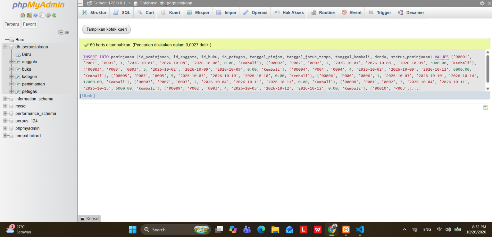
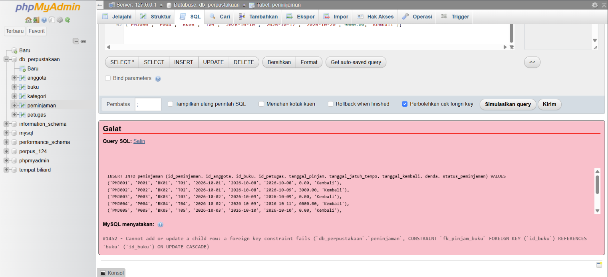
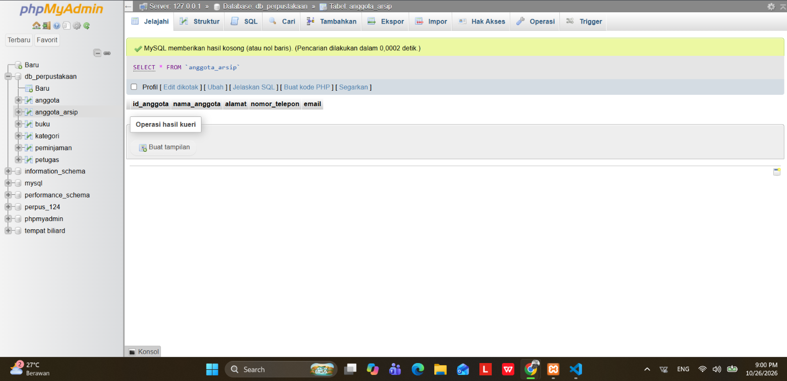
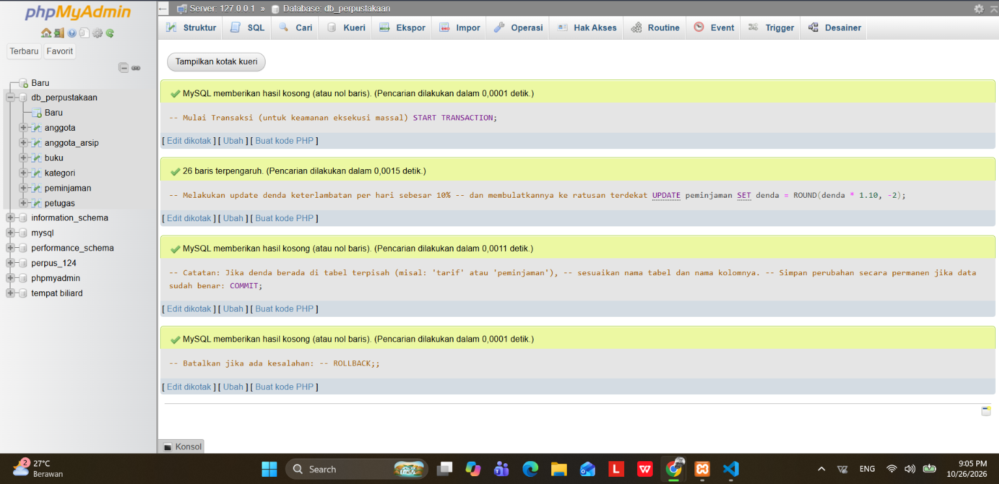

# Laporan Praktikum Basis Data - Pertemuan 06
* Nama : Daffa Bima Perdana
* NPM : 25430124
* Kelas : D
* Pertemuan Ke-06
* Tanggal Pelaksanaan : 28 Oktober 2026
* Dosen Pengampu : Dedi Irawan, S.Kom., M.T.I.

## 1. Tujuan Praktikum
1. Mahasiswa mampu mengimplementasikan data tingkat lanjut (DML) dengan cara menggunakan perintah INSERT ... SELECT, UPDATE dengan fungsi aritmatikan pembulatan, dan penghapusan aman berbasis relasi multi tabel DELETE ... LEFT JOIN.
2. Mahasiswa mampu menyusun sekumpulan data uji realistis dalam volume besar.
3. Mehasiswa mampu mendiagnosis keterbatasan strukturan SQL (CHECK constraint) terhadap aturan bisnis multi-baris dan mendokumentasikan sebagai utang desain.

## 2. Ringkasan Teori
DML atau Data Manipulation Language merupakan himpunan perintah SQL yang digunakan untuk memanipulasi dan memelihara data di dalam tabel relasional tanpa mengubah definisi skema fisiknya.

Prinsip utama DML ini adalah
* Penyalinan Atomik (INSERT INTO ... SELECT) merupakan Menyalurkan kumpulan data transaksi sirkulasi secara langsung antar tabel sejenis di dalam basis data perpustakaan untuk keperluan snapshot historis maupun partisi pengarsipan tanpa membutuhkan pemprosesan di memori aplikasi.
* Kalkulasi Data Terpusat (UPDATE Aritmatika) adalah eksekusi perubahan nilai denda atau tarif berbasis formula matematis di lapisan basis data menjamin prinsip single source of truth dan mencegah inkonsistensi kalkulasi antar platform aplikasi.
* Penghapusan Bersyarat Multi-Tabel (DELETE dengan JOIN) merupakan teknik penggabungan relasi (seperti LEFT JOIN ... WHERE fk IS NULL) untuk memfilter dan menghapus hanya data master yang tidak lagi memiliki rekaman anak aktif pada tabel, menjaga integritas referensial dan mencegah galat foreign key constraint.
* Verifikasi Integritas adalah pengujian data  dilakukan melalui skenario positif (memastikan alur peminjaman valid berhasil diproses) dan skenario negatif (memastikan masukan yang melanggar aturan bisnis ditolak oleh basis data).

## 3. Hasil Langkah

### A. Eksakusi Skrip Populasi Data (60 Baris Transaksi)

### B. Pengujian Negatif (uji tolak)

## 4. Jawaban Titik Analisis
1. Perintah INSERT ... SELECT di atas mengambil harga dari tabel barang. Mengapa
cara ini lebih aman daripada mengetik angka 4000 secara manual? Setelah harga pulpen
naik menjadi Rp4.500 minggu depan, apakah nota PJ-2609-0142 ikut berubah?

        *   Perintah INSERT ... SELECT lebih aman daripada mengetik untuk mencegah kesalahan manusia yang mengambil data harga langsung dari tabel barang menghilangkan risiko salah ketik (typo) saat memasukkan nominal harga.
        *   Untuk kkonsistensi data sehingga memastikan bahwa harga yang dicatat pada transaksi sesuai dengan master data harga jual saat transaksi berlangsung.
        *   Membuat proses otomisasi dan mengurangi proses verifikasi manual terhadap daftar harga barang secara terpisah.
        *   PJ_2609_0142 Tidak berubah karena nilai harga_satuan_detail_penjualan telah disimpan secara permanen didalam tabel detail_penjualan.
        *   Perubahan harga barang di masa mendatang hanya akan mengubah kolom harga_jual_barang di tabel master (barang), sehingga tidak akan memengaruhi data histori penjualan yang sudah tercatat sebelumnya pada tabel detail_penjualan.
2. Menghapus nota menghapus detailnya, tetapi menghapus petugas ditolak. Jelaskan kedua perilaku ini dari definisi constraint di Modul 5. Bagaimana cara yang benar jika seorang kasir berhenti bekerja?

        *   Menghapus nota menghapus detailnya: Hal ini terjadi karena pada relasi tabel tersebut diterapkan aturan ON DELETE CASCADE. Ketika data nota (penjualan) dihapus, sistem secara otomatis akan menghapus seluruh baris data pada tabel anak (detail_penjualan) yang terhubung dengan nota tersebut.
        *   Hal ini terjadi karena data petugas memiliki relasi (foreign key) dengan tabel penjualan dan tidak menggunakan aturan cascade delete pada penghapusan petugas. Jika petugas tersebut pernah melayani transaksi, sistem menolak penghapusan untuk menjaga integritas data (data integrity) dan mencegah data transaksi kehilangan referensi petugasnya.
        *   Tidak menghapus data petugas dan hanya mengubah status akun kasir tersebut menjadi tidak aktif. Dengan cara ini, riwayat transaksi penjualan masa lalu yang pernah dilayanin oleh kasir lama akan tetap aman dan tercatat dengan baik tanpa melanggar aturan constraint database.

3. Semua uji di atas akan berstatus LULUS. Tuliskan satu uji yang Anda perkirakan GAGAL karena aturan bisnisnya belum dijaga server, misalnya penjualan yang qty-nya melebihi stok (AB-03). Mengapa constraint CHECK di tabel barang tidak mencegahnya?

        *   Skenario uji yang diperkirakan gagal yaitu transaksi penjualan dengan jumlah yang melebihi sisa stok barang yang tersedia.
        *   Constraint CHECK tidak mencegahnya?
            -   Karena constraint CHECK pada tabel barang secara mandiri hanya berfungsi untuk memvalidasi batasan nilai kolom di dalam tabel barang itu sendiri.
            -   Constraint tersebut tidak dapat secara otomatis mencocokkan atau memvalidasi nilai lintas tabel (seperti jumlah qty yang diminta pada tabel detail_penjualan terhadap stok di tabel barang pada saat proses transaksi) tanpa bantuan mekanisme tambahan seperti trigger basis data atau validasi logika aplikasi.

## 5. Hasil Latihan
* Pengarsipan Anggota Nonaktif tanpa menghapus anggota bertransaksi

                
                -- 1. Mulai Transaksi (Memastikan keamanan dan integritas data)
                START TRANSACTION;

                -- A. Pembuatan struktur tabel arsip anggota perpustakaan
                CREATE TABLE IF NOT EXISTS anggota_arsip LIKE anggota;

                -- B. Pemindahan data anggota yang tidak memiliki riwayat peminjaman
                INSERT INTO anggota_arsip
                SELECT a.* 
                FROM anggota a
                WHERE a.tgl_daftar < '2025-01-01' 
                  AND NOT EXISTS (
                     SELECT 1 
                     FROM peminjaman p 
                      WHERE p.id_anggota = a.id_anggota
                  );

                -- C. Penghapusan data anggota yang telah diarsipkan dari tabel utama
                DELETE FROM anggota
                WHERE tgl_daftar < '2025-01-01' 
                  AND NOT EXISTS (
                      SELECT 1 
                     FROM peminjaman p 
                      WHERE p.id_anggota = anggota.id_anggota
                 );

                -- 2. Simpan permanen perubahan jika skrip berhasil berjalan tanpa error
                COMMIT;

                

* Kueri kenaikan harga sewa buku sebesar 10%

                -- Mulai Transaksi (untuk keamanan eksekusi massal)
                START TRANSACTION;

                -- Melakukan update denda keterlambatan per hari sebesar 10% 
                -- dan membulatkannya ke ratusan terdekat
                UPDATE peminjaman
                SET denda = ROUND(denda * 1.10, -2);
                -- Catatan: Jika denda berada di tabel terpisah (misal: 'tarif' atau 'peminjaman'), 
                -- sesuaikan nama tabel dan nama kolomnya.

                -- Simpan perubahan secara permanen jika data sudah benar:
                COMMIT;

                

## 6. Tugas Mandiri Milestone Proyek 6

Tugas mandiri berupa berkas populasi data `p06_data_25430124.sql` telah disusun secara idempotent dan memenuhi kuota transaksi ($10 \times P = 10 \times 6 = 60$ baris detail transaksi).

Matriks 10 Skenario Uji Integritas Data Proyek

| No | Jenis Uji | Target Uji / Constraint | Perintah Uji (SQL) | Hasil yang Diharapkan | Status Hasil |
| :--- | :--- | :--- | :--- | :--- | :--- |
| 1 | Positif | `pk_anggota` & `chk_no_hp` | `INSERT INTO anggota VALUES ('P099', 'Uji Coba', '081234567890', '2026-10-28');` | Baris berhasil tersimpan | LOLOS |
| 2 | Negatif | PK Duplikat (`pk_buku`) | `INSERT INTO buku VALUES ('BK001', 'Pemrograman Dasar', 'Teknologi', 3000, 10, 2);` | Ditolak: Duplicate entry 'BK001' | DITOLAK (BENAR) |
| 3 | Negatif | `chk_harga_buku` | `INSERT INTO buku VALUES ('BK098', 'Buku Minus', 'Referensi', -5000, 10, 2);` | Ditolak: Check constraint violated | DITOLAK (BENAR) |
| 4 | Negatif | `chk_stok_min_buku` | `UPDATE buku SET stok_min_buku = -1 WHERE id_buku = 'BK001';` | Ditolak: Check constraint violated | DITOLAK (BENAR) |
| 5 | Negatif | `fk_peminjaman_anggota` | `INSERT INTO peminjaman VALUES ('P399', '2026-10-27', 'P999', 3);` | Ditolak: Foreign key fails (P999 tdk ada) | DITOLAK (BENAR) |
| 6 | Negatif | `chk_qty_batas_p2` | `INSERT INTO detail_peminjaman VALUES ('PMJ0001', 'BK001', 999, 75000);` | Ditolak: Qty melebihi batas 50 unit | DITOLAK (BENAR) |
| 7 | Negatif | Composite PK (`detail_peminjaman`) | `INSERT INTO detail_peminjaman VALUES ('PMJ0001', 'BK001', 1, 75000);` | Ditolak: Duplicate composite key | DITOLAK (BENAR) |
| 8 | Positif | `ON DELETE SET NULL` | `DELETE FROM anggota WHERE id_anggota = 'P007';` | Berhasil: id_anggota di peminjaman jadi NULL | LOLOS |
| 9 | Positif | `ON DELETE CASCADE` (`detail_peminjaman`) | `DELETE FROM peminjaman WHERE id_peminjaman = 'PMJ0060';` | Berhasil: Rincian item PJ60 ikut terhapus | LOLOS |
| 10 | GAGAL (Utang) | Batas Multi-Baris (Maks 10 Buku/Transaksi) | Menambahkan baris ke-11 pada faktur PMJ0001 | Kueri lolos (CHECK tidak bisa agregasi) | UTANG MODUL 14 |

Analisis Kasus Uji Gagal (Utang Desain untuk Modul 14)

* **Aturan Bisnis:** Satu transaksi peminjaman buku dibatasi maksimal hanya boleh menampung 10 jenis buku yang berbeda.
* **Penyebab Gagal Dijaga oleh CHECK:** Standar SQL `CHECK` constraint dievaluasi secara lokal pada baris yang sedang dimanipulasi (*row-level scope*) dan tidak diizinkan menjalankan *subquery* agregasi `SELECT COUNT(*) FROM detail_peminjaman WHERE id_peminjaman = ...`.
* **Solusi Rencana Modul 14:** Mengimplementasikan *trigger* `BEFORE INSERT ON detail_peminjaman` yang memvalidasi jumlah baris aktif pada transaksi bersangkutan, lalu membangkitkan `SIGNAL SQLSTATE '30000'` untuk membatalkan proses penyisipan data jika kuota 10 item terlampaui.

## 7. Pembahasan Dan Kendala
Proses eksekusi skrip data awal sempat terhenti karena muncul galat #1701 - Cannot truncate a table referenced in a foreign key constraint saat pengosongan data via TRUNCATE. Hal ini disebabkan oleh mekanisme Engine InnoDB MySQL yang melarang pengosongan tabel induk apabila masih dirujuk oleh tabel anak (seperti relasi peminjaman dengan detail_peminjaman), walaupun pemeriksaan foreign key telah dinonaktifkan sementara. Masalah ini diselesaikan dengan mengganti skrip pengosongan menjadi DELETE FROM yang dieksekusi secara berurutan mulai dari tabel anak terdalam hingga ke tabel induk (peminjaman, buku, anggota).

## 8. Kesimpulan
Penerapan operasi DML lanjutan serta pengisian 60 baris data uji pada berkas p06_data_25430124.sql telah sukses dijalankan pada skema basis data perpus_124. Hasil pengujian menunjukkan bahwa validasi integritas entitas, referensial, dan domain baris tunggal berjalan dengan baik, sementara aturan batas kardinalitas antar-baris telah dicatat secara sistematis sebagai catatan perancangan (design debt) yang nantinya akan diselesaikan menggunakan Trigger pada Modul berikutnya.

## 9. Pernyataan Penggunaan AI
Pada praktikum ini AI yang digunakan yaitu Gemin AI dan ChatGPT yang diterapkan untuk merancang pola tanggal pinjam dan kembali serta relasi kunci data sirkulasi, menyusun kueri pembersihan data pustaka tanpa merusak integritas tabel, serta menata format pengujian integritas data untuk laporan.

## 10. Bukti Git
Tautan Repositori : https://github.com/DaffaBimaPerdana30/Basisdata-25430124

Berkas milestone : https://github.com/DaffaBimaPerdana30/Basisdata-25430124/blob/main/p06_data_25430124.sql

### Checklist Umum Laporan Praktikum (Tabel P.13)

| Butir | Yang Harus Ada | Status |
| :--- | :--- | :---: |
| **Identitas** | Nama, NIM, kelas, pertemuan ke-6, tanggal pelaksanaan, nama asisten/dosen | [x] |
| **Tujuan** | Tujuan praktikum ditulis ulang dengan bahasa sendiri (maksimal 5 baris) | [x] |
| **Ringkasan teori** | Pemahaman sendiri atas Dasar Teori, maksimal setengah halaman, tanpa menyalin buku | [x] |
| **Langkah percobaan (D)** | Tangkapan layar hasil langkah kunci sesuai checklist khusus, masing-masing diberi keterangan singkat | [x] |
| **Titik Analisis** | Semua Titik Analisis dijawab lengkap dengan alasan, bukan sekadar ya/tidak | [x] |
| **Latihan (E)** | Skrip/dokumen hasil latihan beserta bukti berjalan | [x] |
| **Tugas Mandiri (F)** | Milestone proyek pertemuan ini: berkas, bukti, dan penjelasan keputusan desain | [x] |
| **Pembahasan dan kendala** | Galat yang ditemui, cara membacanya, dan cara mengatasinya | [x] |
| **Kesimpulan** | Dua sampai empat kalimat dengan bahasa sendiri | [x] |
| **Pernyataan Penggunaan AI** | Alat yang dipakai, untuk apa, bagian mana; tulis "tidak menggunakan" bila tidak memakai | [x] |
| **Bukti Git** | Tautan repositori dan kode *commit* (hash) pertemuan ini dengan pesan `pNN: ...` | [x] |
| **Keaslian** | Setiap tangkapan layar memperlihatkan akun ber-NIM dan jam sistem; nama objek memuat NIM/inisial | [x] |

### Checklist Khusus Laporan Pertemuan 6 (Tabel 6.3)

| Jenis | Yang Harus Ada | Status |
| :--- | :--- | :---: |
| **Berkas wajib** | `p06_data_<NIM>.sql` (skrip data DML lengkap) | [x] |
| **Volume data** | Master minimal 5 baris; transaksi minimal 60 baris ($10 \times P$) pada $\ge 3$ tanggal | [x] |
| **Skenario uji** | Minimal 10 skenario uji (minimal 5 negatif); 1 uji gagal dicatat sebagai utang Modul 14 | [x] |
| **Bukti tangkapan layar** | Bukti eksekusi skrip data DML dan pembuktian kueri Latihan E | [x] |