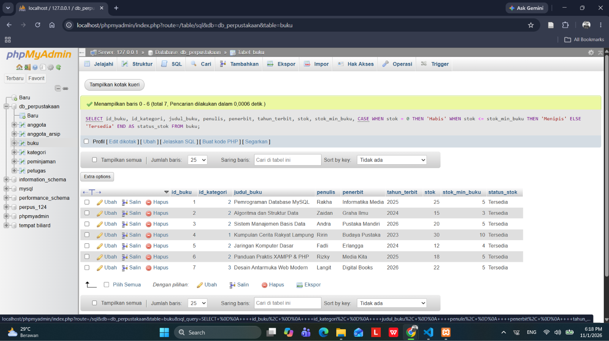
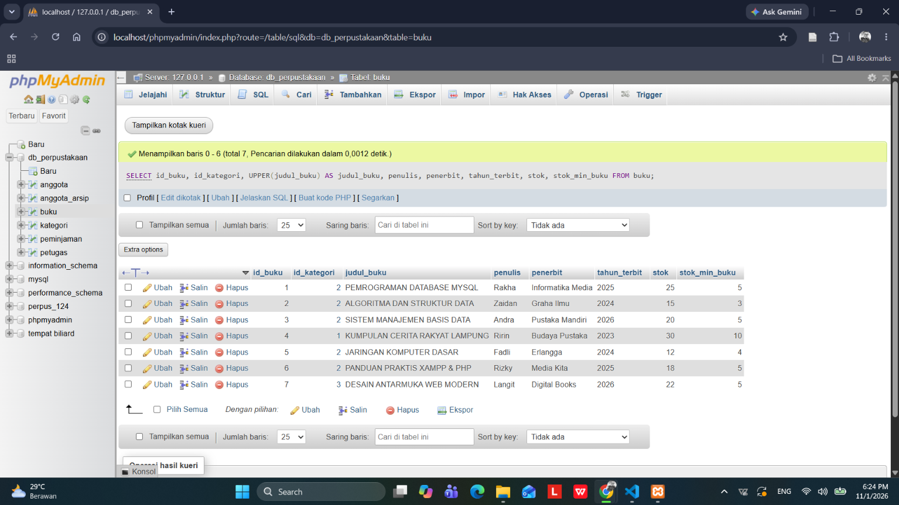
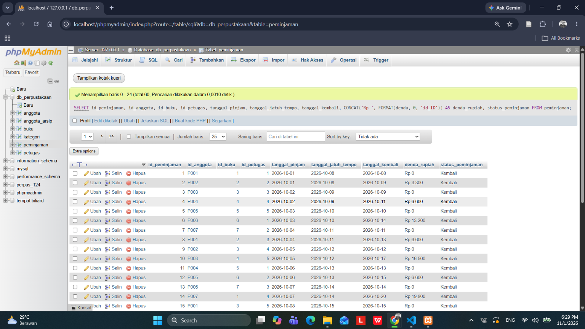
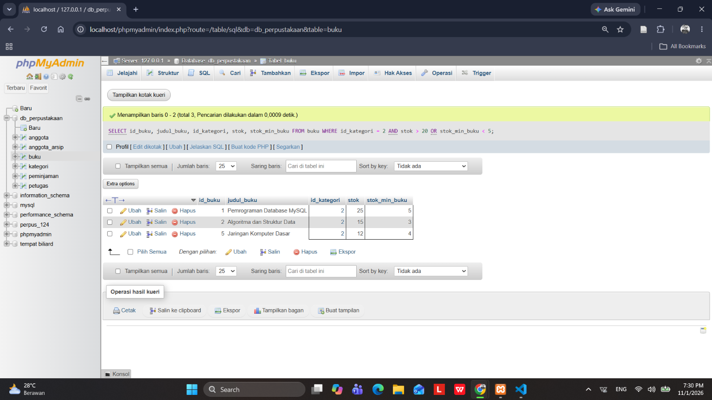

# Laporan Praktikum Basis Data - Pertemuan 07
* Nama : Daffa Bima Perdana
* NPM : 25430124
* Kelas : D
* Pertemuan Ke-07
* Tanggal Pelaksanaan : 04 November 2026
* Dosen Pengampu : Dedi Irawan, S.Kom., M.T.I.

## 1. Tujuan Praktikum
1. Mahasiswa mampu menyusun kueri seleksi data tngkat dasar sampai menengah pada satu tabel menggunakan klausa WHERE, operator pola dan rentang seperti LIKE, BETWEEN, IN, IS NULL, operator logika dan fungsi pembanding SQL.
2. Mahasiswa mampu menganalisis kesalahan pada operator logika (AND/OR) dan membedakan kebutuhan informasi yang dapat diselesaikan pada satu tabel dengan relasi multi-tabel(JOIN).
3. Mahasiswa mampu menerapkan fungsi bawaan string, format tanggal dan logika percabangan kondisional CASE ... WHEN.

## 2. Ringkasan Teori
Kueri seleksi data merupakan dasar manupulasi informasi dalam Sistem Manajemen Basis Data Relasional (RDBMS) yang berfokus pada penyaringan baris (horizontal filtering) dan pemilihan atribut (vertical projection).
Empat komponen utama kueri satu tabel adalah:
*   Operator penyaringan nilai

    *   BETWEEN ... AND ... : digunakan untuk menyaring data dalam rentang inklusif
    *   IN (...) : digunakan untuk mencocokkan nilai dengan daftar himpunan diskrit.
    *   IS NULL/IS NOT NULL : digunakan untuk mendeteksi nilai kosong yang tidak bisa diperiksa dengan operator aritmatika biasa.
*   Pencarian pola teks (LIKE) digunakan untuk karakter wildcard % (untuk banyak karakter) dan _ (untuk satu karakter) untuk menemukan substring pada kolom teks.
*   Presedensi Operator Logika digunakan untuk Operator AND dieksekusi lebih dulu dibandingkan OR. dengan tanpa tanda kurung (), kondisi ini dapat memicu kesalahan semantik dimana kueri berjalan lancar tetapi hasil datanya salah/keliru.
*   Ekspresi Kondisional (CASE) digunakan untuk membuat percabangan logika dalam kueri untuk mengelompokkan atau mengubah data mentah menjadi kategori baru tanpa mengubah data asli pada tabel.

## 3. Hasil Percobaan
### A. Eksekusi Kueri Seleksi Satu Tabel (Status Stok Buku)

**Keterangan Gambar: phpMyAdmin berhasil mengeksekusi kueri klasifikasi stok buku dengan membagi kondisi stok buku ke dalam label 'Habis', 'Menipis' dan 'tersedia' berdasarkan perbandingan nilai terhadap stok_min_buku secara akurat.**

## 4. Titik Analisis
1. Ganti ORDER BY kurang menjadi WHERE kurang > 0. Catat galat yang muncul dan jelaskan dengan urutan evaluasi pada Gambar 7.1. Bagaimana menulis syarat yang setara tanpa memakai alias?

        *   Galat yang Muncul pada analisis pertama adalah sistem basis data akan memunculkan pesan kesalahan (error) seperti Unknown column 'kurang' in 'where clause'.
        *   Penjelasan Berdasarkan Urutan Evaluasi SQL adalah Klausa WHERE dieksekusi lebih awal oleh mesin database dibanding klausa SELECT. Karena alias kurang baru didefinisikan di dalam klausa SELECT (stok_min_barang - stok_barang AS kurang), maka pada saat pengecekan WHERE, alias tersebut belum dikenali oleh sistem.
        *   Untuk menghindari galat tersebut tanpa menggunakan alias. digunakan SQL berikut:

                SELECT kode_barang, nama_barang, stok_barang, stok_min_barang, stok_min_barang - stok_barang AS kurang
                FROM barang
                WHERE (stok_min_barang - stok_barang) > 0
                ORDER BY kurang DESC;

2. Mengapa WHERE no_hp_anggota = NULL tidak pernah mengembalikan baris, padahal ada anggota tanpa nomor HP? Tulis kueri yang benar, lalu jelaskan perbedaan NULL dengan string kosong ''.

        *   Karena dalam SQL, NULL mempresentasikan nilai yang tidak diketahui atau tidak terdefinisi. NULL bukan sebuah nilai yang dapat dibandingkan menggunakan operator seperti =, < atau != . Operasi perbandingan matematika dengan NULL akan selalu menghasilkan nilai yang bernilai tidak benar (unknown), sehingga tidak ada baris yang lolos dari penyaringan WHERE. Oleh karena itu, digunakan operator khusus yaitu IS NULL atau IS NOT NULL untuk pemeriksaan nilai kosong.
        *   Kueri yang benar untuk menampilkan anggota yang tidak memiliki nomor HP adalah:

            SELECT *
            FROM anggota
            WHERE no_hp_anggota IS NULL:

        *   Perbedaan NULL dengan String Kosong adalah NULL menyatakan ketiadaan data atau nilai sama sekali sehingga kolom tersebut kosong dan belum pernah diisi data. Sedangkan String kosong ('') adalah sebuah data berupa teks sah yang memikili 0 karakter. kolom sudah terisi tetapi berisi karakter kosong.

3. Subtotal per baris dapat dihitung di modul ini, tetapi total nota belum. Mengapa? Fitur SQL apa yang dibutuhkan untuk menjumlahkan banyak baris menjadi satu nilai? (Jawabannya dipelajari di Pertemuan 9.)

        Karena Perhitungan subtotal pada modul ini dilakukan secara per baris (row-level calculation). Artinya, ekspresi matematika (seperti qty_detail_penjualan * harga_satuan_detail_penjualan) hanya memproses kolom-kolom yang berada di dalam baris itu sendiri secara independen. Sistem belum dirancang untuk mengakumulasi atau menggabungkan nilai dari beberapa baris data yang berbeda ke dalam satu nilai akumulatif (total keseluruhan nota).
        Fitur yang dibutuhkan untuk menjumlahkan banyak baris data menjadi satu nilai tunggal adalah fungsi SUM() yang merupakan fungsi agregasi yang dapat dikombinasikan dengan klausa pengelompokkan seperti GROUP BY.

## 5. Hasil Latihan
1. Latihan E.1 Pemrofmaan Huruf Kapital dan Format Rupiah.

Kueri untuk mengubah nama buku ke huruf besar (kapital) serta memformat harga menjadi format mata uang Rupiah Indonesia ("Rp3.000"):

        SELECT 
                id_buku, 
                id_kategori, 
                UPPER(judul_buku) AS judul_buku, 
                penulis, 
                penerbit, 
                tahun_terbit, 
                stok, 
                stok_min_buku
        FROM buku;

**Keterangan Gambar: Fungsi UPPER() digunakan untuk mengubah string nama buku menjadi huruf kapital penuh.**

        SELECT 
                id_peminjaman, 
                id_anggota, 
                id_buku, 
                id_petugas, 
                tanggal_pinjam, 
                tanggal_jatuh_tempo, 
                tanggal_kembali, 
                CONCAT('Rp ', FORMAT(denda, 0, 'id_ID')) AS denda_rupiah, 
                status_peminjaman
        FROM peminjaman;

**Keterangan CONCAT() dengan FORMAT(..., 0, 'id_ID') berhasil dieksekusi sebagai format moneter sesuai kaidah lokal dengan pemisah ribuan titik.

2. Latihan E.2 Analisis Kueri Salah Semantik dan Perbaikannya

    * Kueri Salah Semantik
        
        Kasus Bisnis
        
            SELECT 
                id_buku, 
                judul_buku, 
                id_kategori, 
                stok, 
                stok_min_buku
                FROM buku
                WHERE id_kategori = 2 
                AND stok > 20 OR stok_min_buku < 5;

**Pada gambar diatas memiliki masalah Kueri tetap berjalan tanpa galat sintaks, namun buku dari non-kategori utama (seperti Cerita Rakyat yang stoknya < 5) ikut tampil karena MySQL mengevaluasi (id_kategori = 2 AND stok > 20) sebagai satu blok terpisah dari OR stok_min_buku < 5.**

    * Kueri yang telah diperbaiki

                SELECT 
                        id_buku, 
                        judul_buku, 
                        id_kategori, 
                        stok, 
                        stok_min_buku
                FROM buku
                WHERE id_kategori = 2 
                AND (stok > 20 OR stok_min_buku < 5);

**Pada gambar diatas penambahan tanda kurung (stok > 20 OR stok_min_buku < 5) memastikan penyaringan kategori id_kategori = 2 menjadi syarat mutlak, sehingga data dari kategori lain langsung tereliminasi dan hasil kueri sesuai dengan maksud pelayanan perpustakaan yang sesungguhnya.**

## 6. Tugas Mandiri Milestone Proyek 7
Berkas skrip kueri telah disimpan pada direktori dengan nama p07_kueri_25430124.sql.

Ringkasan Pemenuhan Kebutuhan Informasi (10 Kueri satu Tabel)

## Ringkasan Pemenuhan Kebutuhan Informasi (10 Kueri Satu Tabel - Konteks Perpustakaan)

| No | Kode KI | Ringkasan Pertanyaan Bisnis (Perpustakaan) | Syarat Modul Terpenuhi | Ekspektasi Luaran |
| :---: | :---: | :--- | :--- | :--- |
| **1** | KI-01 | Cari judul buku dengan kata kunci 'Pemrograman' atau 'Database' | `LIKE`, Fungsi String | Menampilkan buku yang judulnya cocok dengan pola kata kunci |
| **2** | KI-02 | Filter buku dengan rentang harga peminjaman Rp3.000 s/d Rp5.000 | `BETWEEN` | Daftar buku kategori harga sewa ekonomis-menengah |
| **3** | KI-03 | Tampilkan buku kelompok 'Fiksi' atau 'Sains' | `IN` | Baris buku dari kategori terkait |
| **4** | KI-04 | Audit peminjaman buku tanpa nomor kartu anggota (Peminjam Umum/Tamu) | `IS NULL` | Riwayat peminjaman dengan ID anggota kosong |
| **5** | KI-05 | Klasifikasikan tingkat ketersediaan stok fisik buku di perpustakaan | `CASE` | Status stok: Kritis, Waspada, atau Aman |
| **6** | KI-06 | Rekap peminjaman buku periode Oktober 2026 dengan durasi pinjam panjang | Fungsi Tanggal (`YEAR`, `MONTH`) | Data peminjaman pada periode target sesuai kriteria |
| **7** | KI-07 | Standardisasi format teks nama anggota kapital & panjang digit nomor anggota | `UPPER`, `CONCAT`, `LENGTH` | Profil anggota dengan format teks standar |
| **8** | KI-08 | Hitung durasi masa aktif keanggotaan perpustakaan (hari) | `DATEDIFF`, `CURDATE` | Kolom lama bergabung dalam satuan hari |
| **9** | KI-09 | Filter transaksi peminjaman borongan/jumlah buku tinggi (jumlah $\ge$ 3 buku) | Operator Logika & Perbandingan | Detail peminjaman dengan subtotal buku dipinjam |
| **10** | KI-10 | Pengelompokan level keanggotaan pembaca perpustakaan (Platinum/Gold/Standar) | `CASE`, Relasional | Label kategori keanggotaan per profil/transaksi |

Identifikasi Kebutuhan Informasi (KI) yang Membutuhkan Multi-Tabel

1. KI-BELUM-01 (Rekap Peminjaman per Nama Anggota):
   Alasan: Informasi nama anggota berada di tabel anggota, sedangkan data aktivitas peminjaman berada di tabel peminjaman. Perlu relasi JOIN antara kedua tabel tersebut.

2. KI-BELUM-02 (Rincian Judul Buku pada Setiap Transaksi Peminjaman):
   Alasan: Tabel detail_peminjaman hanya menyimpan foreign key id_buku. Untuk menampilkan atribut deskriptif seperti judul_buku dan kategori_buku, dibutuhkan relasi JOIN ke tabel master buku.
   Tindak Lanjut: Kedua kebutuhan informasi ini ditandai sebagai utang implementasi untuk diselesaikan pada Pertemuan 9–12.

## 7. Pembahasan dan Kendala

*   Kendala yang Ditemui adlah Ketika menguji fungsi FORMAT(denda, 0, 'id_ID') untuk merapikan nominal denda, pengaturan locale pada MySQL lokal sempat gagal menampilkan format titik (.) sebagai pemisah ribuan standar Indonesia, dan malah memunculkan koma (,).
*   Perilaku fungsi FORMAT() sangat bergantung pada kecocokan dukungan lokal string yang terpasang pada server MySQL yang berjalan.
*   Solusi dari kendala adalah menambahkan parameter kode lokal secara tegas pada fungsi string, dan memastikan agar hasil akhir nominal denda tetap mudah dipahami oleh anggota perpustakaan.

## 8. Kesimpulan

Pada Modul 7 ini mahasiswa sukses merampungkan berbagai macam implementasi kueri satu tabel mulai dari pencarian pola teks, rentang nilai, penanganan data kosong, manipulasi tanggal dan string, hingga penggunaan percabangan CASE. Pemahaman mengenai prioritas operator logika terbukti sangat krusial dalam mencegah kesalahan logika saat mengambil data peminjaman perpustakaan. Selain itu, kebutuhan informasi yang membutuhkan relasi antar tabel telah berhasil dipetakan untuk diselesaikan pada modul multi-tabel selanjutnya.

## 9. Pernyataan Penggunaan AI
Pada praktikum 7 ini digunakan Teknologi AI berupa GeminiAI dan ChatGPT untuk membantu meneliti studi kasus terkait aturan prioritas logika AND atau OR pada pengolahan data peminjaman buku nyata, merancang berbagai variasi ekspresi kondisional CASE untuk mengecek status ketersediaan koleksi pustaka, serta menyusun struktur laporan akhir yang sesuai dengan daftar periksa akademik modul praktikum perpustakaan.

## 10. Bukti Git

*   Tautan Repositori : https://github.com/DaffaBimaPerdana30/Basisdata-25430124
*   Kueri mandiri disimpan pada direktori dengan nama p07_kueri_25430124.sql.

___

### Checklist Umum Laporan Praktikum (Tabel P.13)

| Butir | Yang Harus Ada | Status |
|---|---|---|
| **Identitas** | Nama, NIM, kelas, pertemuan ke-N, tanggal pelaksanaan, nama asisten/dosen | [x] |
| **Tujuan** | Tujuan praktikum ditulis ulang dengan bahasa sendiri (maksimal 5 baris) | [x] |
| **Ringkasan teori** | Pemahaman sendiri atas Dasar Teori, maksimal setengah halaman, tanpa menyalin buku | [x] |
| **Langkah percobaan (D)** | Tangkapan layar hasil langkah kunci sesuai checklist khusus, masing-masing diberi keterangan singkat | [x] |
| **Titik Analisis** | Semua Titik Analisis dijawab lengkap dengan alasan, bukan sekadar ya/tidak | [x] |
| **Latihan (E)** | Skrip/dokumen hasil latihan beserta bukti berjalan | [x] |
| **Tugas Mandiri (F)** | Milestone proyek pertemuan ini: berkas, bukti, dan penjelasan keputusan desain | [x] |
| **Pembahasan dan kendala** | Galat yang ditemui, cara membacanya, dan cara mengatasinya | [x] |
| **Kesimpulan** | Dua sampai empat kalimat dengan bahasa sendiri | [x] |
| **Pernyataan Penggunaan AI** | Alat yang dipakai, untuk apa, bagian mana; tulis "tidak menggunakan" bila tidak memakai | [x] |
| **Bukti Git** | Tautan repositori dan kode *commit* (hash) pertemuan ini dengan pesan `pNN: ...` | [x] |
| **Keaslian** | Setiap tangkapan layar memperlihatkan akun ber-NIM dan jam sistem; nama objek memuat NIM/inisial | [x] |

### Checklist Khusus Laporan Pertemuan 7

| Jenis | Yang Harus Ada | Status |
|---|---|---|
| **Berkas wajib** | `p07_kueri_<NIM>.sql` (minimal 10 kueri satu tabel mendukung KI) | [x] |
| **Operator wajib** | Memuat `LIKE`, `BETWEEN`, `IN`, `IS NULL`, `CASE`, fungsi tanggal, dan fungsi string | [x] |
| **Bukti tangkapan layar** | Latihan E.1 (Format Rupiah & UPPER), Latihan E.2 (Kueri Semantik Salah & Benar), dan Tugas Mandiri | [x] |
| **Analisis wajib** | Penandaan KI yang belum bisa dijawab dengan satu tabel (untuk Pertemuan 9–12) | [x] |