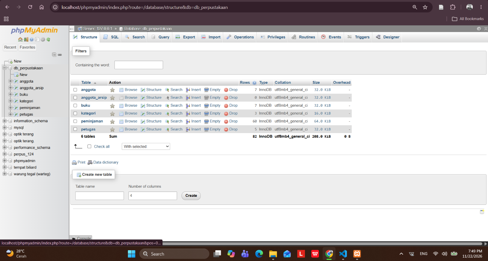

# Laporan Praktikum Basis Data - Pertemuan 08 UTS
* Nama : Daffa Bima Perdana
* NPM : 25430124
* Kelas : D
* Pertemuan Ke-08
* Tanggal Pelaksanaan : 11 November 2026
* Dosen Pengampu : Dedi Irawan, S.Kom., M.T.I.

# 1. Tujuan Praktikum / UTS
1. Pada Praktikum ini mahasiswa diharapkan mampu untuk memastikan database yang telah dibuat dapat berjalan dengan baik, memahami hubungan dan struktur dari tabel, melatih penggunaan SQL untuk merubah data, dan mengatasi galat yang terjadi.
2. Pada Praktikum ini mahasiswa mampu memahami dan mengimplementasi skirp instalansi bersih basis data relasional secara otomatis.
3. Pada praktikum ini mahasiswa diharapkan mampu melakukan otomatiasi pembuatan data, pemanggilan struktur DDL, pengisian data sampel DML.

# 2. Ringkasan Dasar
* Instalasi Bersih atau Clean Installation merupakan proses menghapus basis data lama dan membangin kembali struktur serta datanya dari awal secara bersih.

# 3. Hasil Percobaan
Berkas install_uts_25430124.sql berhasil dibuat dan dieksekusi skrip instalasi bersih otomatis.

        DROP DATABASE IF EXISTS perpus_124;
        CREATE DATABASE perpus_124;
        USE perpus_124;

        SOURCE p05_ddl_25430124.sql;
        SOURCE p06_data_25430124.sql;

Gambar diatas merupakan clean install yang berhasil dieksekusi.

# 4. Titik Analisis
Perintah SQL memiliki peraturan dan fungsi yang berbeda. Penambahan constraint dapat membataso data yang masuk dan perubahan pada Foreign Ket dapat mempengaruhi data pada tabel lain.

# 5. Hasil Latihan dan Modifikasi
Clean Install skrip install_uts_25430124.sql dapat dieksekusi tanpa adanya galat yang muncul.

# 6. Tugas Mandiri Milesstone Proyek 08 / UTS
1. Dilakukan pengecekan kembali terhadap proyek Peminjaman Perpustakaan yang telah dikerjakan dari Laporan 1 sampai laporan 7. 
2. Menyelesaikan penginstalan CLEAN INSTALL basis data secara utuh dan terintegrasi dari tahap DDL, DML kedalam berkas install_uts_25430124.sql.

# 7. Pembahasan dan Kendala
Kendala yang dialami adalah adanya eror atau galat saat menjalankan skrip. Kendala berhasil setelah merapikan struktur tabel dan ketika di eksekusi skrip berhasil terinstall.

# 8. Kesimpulan
Pada Praktikum 8 ini mahasiswa mampu memahami pengertian dan perintah CLEAN INSTALLATION. mahasiswa juga mampu untuk merancang dan mengeksekusi instalasi bersih secara otomatis.
# 9. Pernyataan penggunaan AI
Pada praktikum 8 ini digunakan Teknologi AI berupa GeminiAI dan ChatGPT untuk membantu merancang dan mengeksekusi instalasi bersih secara otomatis. Memperbaiku galat jika ada dan mengimplementasikan DDL dan DML dan melakukan verifikasi dengan sukses.
# 10. Bukti Git
*   Tautan Repositori : https://github.com/DaffaBimaPerdana30/Basisdata-25430124
*   git commit : 80c88d2

## Checklist Laporan Pertemuan 8
| Jenis | Yang harus ada |
|---|---|
| ☑ Berkas wajib |p08_uts_25430124.md (ringkasan milestone 1–7) dan install_uts_25430124.sql|
| ☑ Bukti tangkapan layar |Bukti basis data berjalan dari skrip DDL dan data (instalasi bersih)|
| ☑ Analisis wajib |Catatan modifikasi langsung saat demo; refleksi keputusan desain yang akan diperbaiki |
